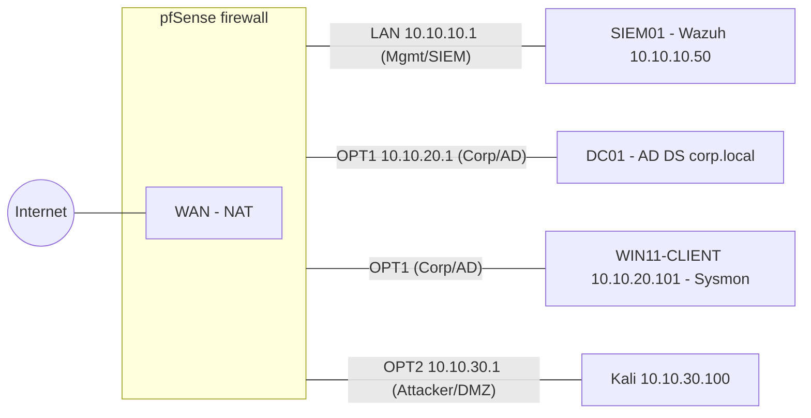

# Network diagram

| Segment | Subnet | VirtualBox network | pfSense interface | Hosts |
|---|---|---|---|---|
| Mgmt / SIEM | 10.10.10.0/24 | vboxnet0 (host 10.10.10.1) | LAN | SIEM01 (static 10.10.10.50) |
| Corp / AD | 10.10.20.0/24 | vboxnet1 (host 10.10.20.1) | OPT1 (CORP_AD) | DC01, WIN11-CLIENT (DHCP 10.10.20.101) |
| Attacker / DMZ | 10.10.30.0/24 | vboxnet2 (host 10.10.30.1) | OPT2 (ATTACKER_DMZ) | Kali (10.10.30.100) |
| WAN | NAT | NAT | WAN | pfSense uplink |

Host-only networks have DHCP disabled. pfSense serves DHCP on each segment.
