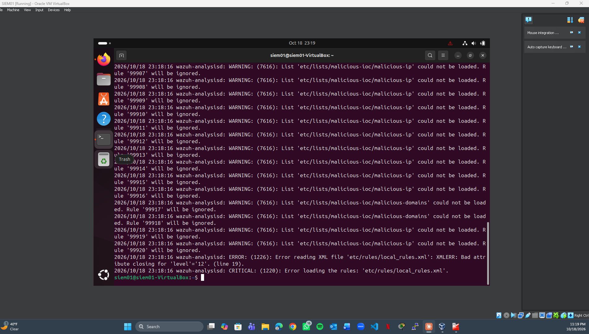
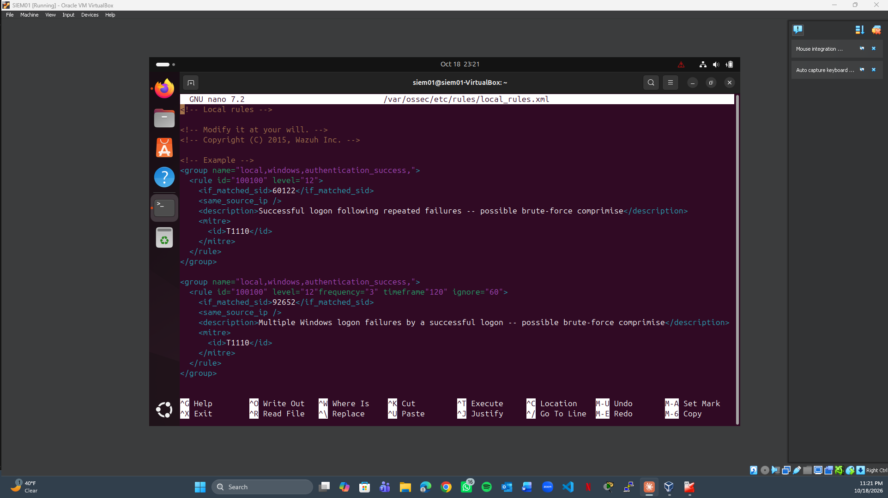
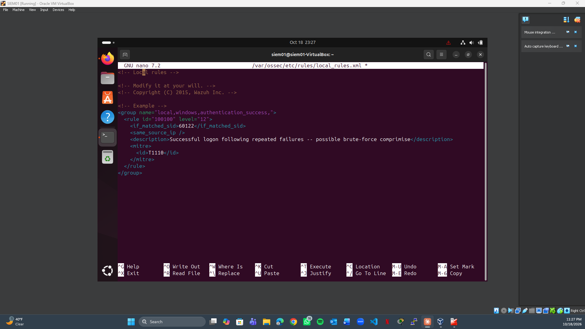
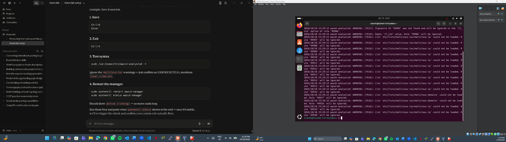
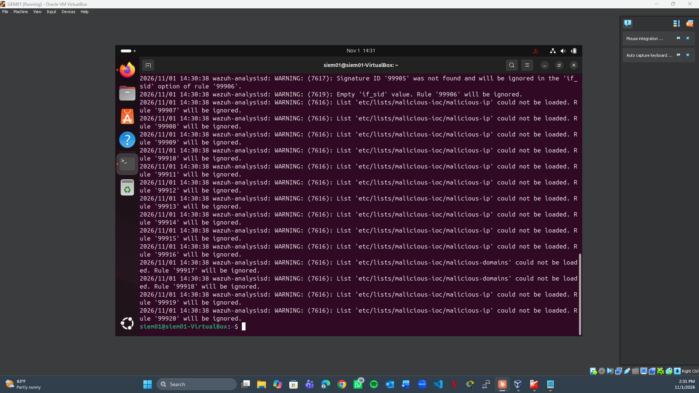

# Troubleshooting log

Problems hit while building the lab, and what resolved them.

| Symptom | What resolved it | Screenshot |
|---|---|---|
| `VERR_INTNET_FLT_IF_NOT_FOUND` when attaching a VM | Fixed the host-only network setup in VirtualBox | Project notes |
| pfSense OPT1 pings and DNS failed | Changed the CORP_AD rule from TCP-only to protocol Any | Project notes |
| WIN11-CLIENT could not resolve internet names | DNS forwarders on DC01 and the CORP_AD rule | Project notes |
| Pings and SMB from Kali blocked although pfSense allowed them | Windows Firewall rules scoped to `LocalSubnet4`. Fixed with `scripts/windows-firewall-lab-scope.ps1` (lab only) | Project notes |
| Sysmon events missing in Wazuh | Added the Sysmon eventchannel `localfile` (`wazuh/ossec-agent-sysmon-localfile.xml`) | Project notes |
| Wazuh dashboard crash loop | Cert filename mismatch: config expected `dashboard-key.pem` and `dashboard.pem`, files were `wazuh-dashboard-*.pem`. Created symlinks with the expected names | Project notes |
| Wazuh indexer timed out on first start after a cold boot | Retried, and it came up | Project notes |
| Wazuh manager would not start after rule edits | XML errors: duplicate rule blocks, bad attribute spacing (`level="12"frequency=...`), then a missing `=`. Rewrote the file and validated before restarting | See below |
| Rule 100100 never fired | `if_matched_sid` alone was not enough. Adding `if_sid` 92652 helped. `same_source_ip` still blocked the correlation, so it was removed | See below |
| VirtualBox `VERR_DISK_FULL` on SIEM01 | The host's physical disk was full, not the VM disk. Freed host space and resumed | Project notes |
| Hydra RDP and SMB attacks failed | Switched to netexec (`nxc smb`) | See below |
| netexec `Broken Pipe` errors on multi-password runs | A single explicit password test worked | See below |
| Windows Firewall agent went inactive after config edits | Restarted the Wazuh agent service | Project notes |
| Config check output noisy | `malicious-ioc` list warnings are expected in this build. Only ERROR and CRITICAL lines indicate a real problem | See below |

## Screenshots

**Bad attribute in local_rules.xml (XML error)**

**Duplicate rule blocks**

**Rule 100100 before same_source_ip was removed**

**Config test passes after cleanup**

**Config test passes before rule fires**

